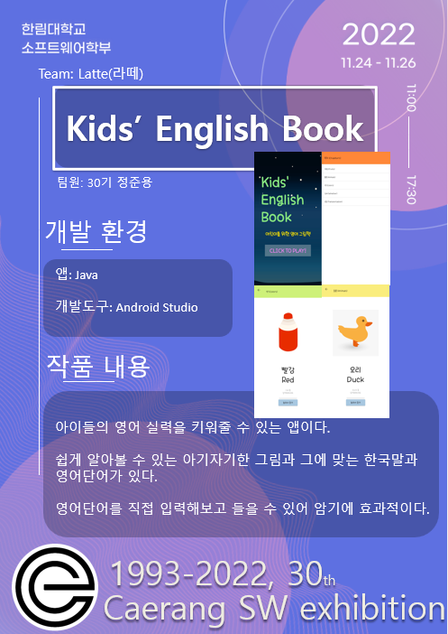
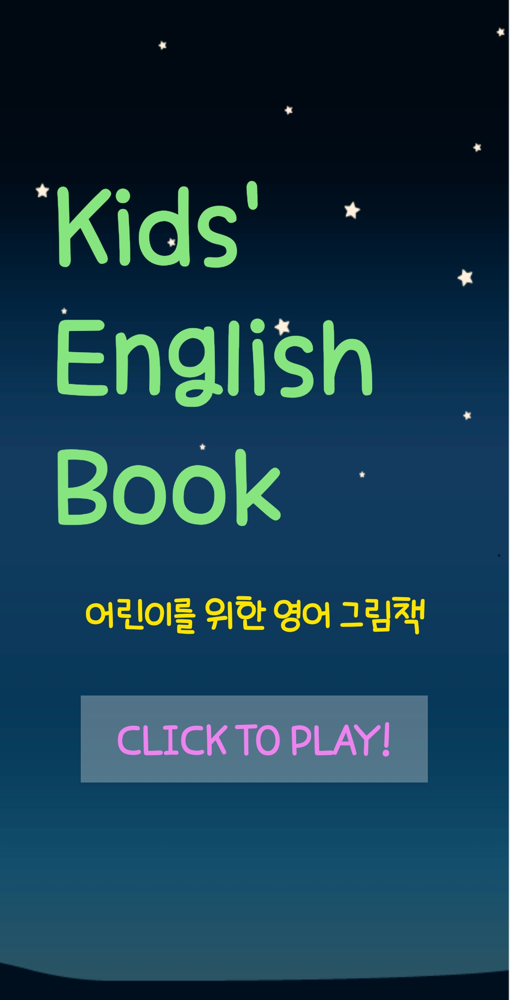
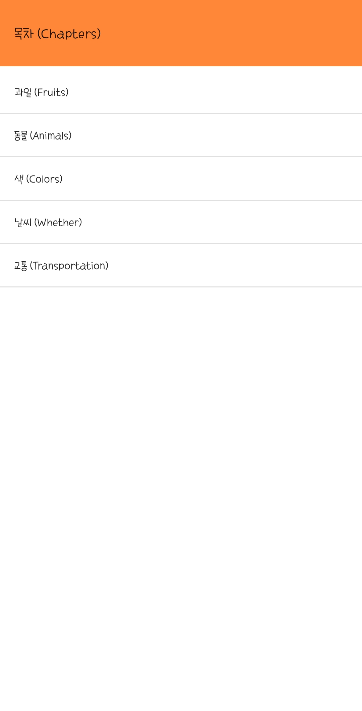
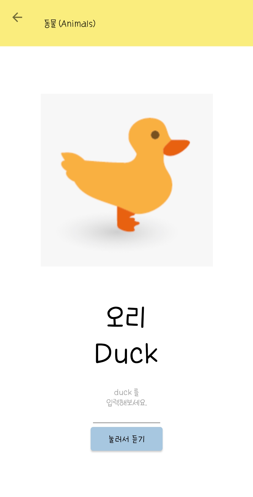
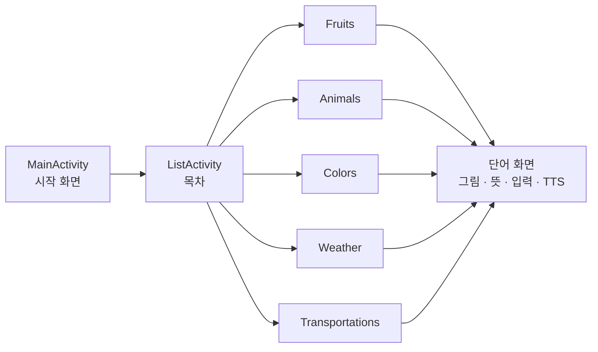

<div align="center">

# 📖 Kids' English Book

**그림을 보고, 직접 쓰고, 소리로 듣는 어린이 영어 단어 그림책 앱**


2022 한림대학교 소프트웨어학부 **제30회 Caerang SW 전시회** 출품작 (2022.11.24 – 11.26)



</div>

---

## 📱 Screenshots

| 시작 화면 | 목차 | 단어 학습 |
|:---:|:---:|:---:|
|  |  |  |

## 💡 About

영어를 처음 접하는 아이들이 **그림 → 한글 뜻 → 영어 단어 → 발음** 순서로 자연스럽게 단어를 익히도록 만든 그림책 앱입니다.
단어를 눈으로 보는 데서 끝나지 않고, **직접 입력한 철자를 TTS로 들려주어** 쓰기와 듣기를 함께 연습할 수 있습니다.

## ✨ Features

- **5개 주제, 31개 단어** — 과일 · 동물 · 색 · 날씨 · 교통
- **그림 카드 학습** — 아이 눈높이의 일러스트와 한글/영어 단어를 한 화면에
- **따라 쓰고 듣기** — 입력한 영어 단어를 Android `TextToSpeech`(en-US, 0.8배속)로 읽어 줌
- **주제별 색상 테마** — 챕터마다 다른 툴바 색으로 현재 위치를 직관적으로 구분

## 🧭 App Flow



## 🛠 Tech Stack

| 구분 | 내용 |
|---|---|
| Language | Java 8 |
| IDE | Android Studio |
| Build | Gradle 7.5 / AGP 7.3.0 |
| UI | AppCompat, ConstraintLayout, Material Components, ListView |
| 음성 | `android.speech.tts.TextToSpeech` |

## 📂 Project Structure

```
app/src/main/
├── java/com/jjun/myenglishbook/
│   ├── MainActivity.java        # 시작 화면
│   ├── ListActivity.java        # 목차 (주제 선택)
│   ├── Fruits.java …            # 주제별 단어 목록
│   └── FruitsApple.java …       # 단어 학습 화면 (그림 + TTS)
└── res/
    ├── layout/                  # 화면 레이아웃
    └── drawable/                # 단어 일러스트
```

## ▶️ Getting Started

```bash
git clone https://github.com/startercube/MyEnglishBook.git
```

Android Studio에서 프로젝트를 열고 실행하거나, 아래 명령으로 APK를 빌드합니다.

```bash
./gradlew assembleDebug
```

빌드된 APK를 바로 설치해 보려면 [`app/release/app-release.apk`](app/release/app-release.apk)를 사용하세요.

## 🔍 Retrospective

첫 Android 프로젝트로, 동작하는 앱을 전시까지 완성하는 데 집중했습니다. 다시 만든다면 다음을 개선하겠습니다.

- **화면 재사용** — 단어마다 Activity를 하나씩 만들어 38개가 되었습니다. 단어 데이터를 리스트로 분리하고 하나의 화면(또는 RecyclerView + Fragment)에서 렌더링하면 단어 추가가 데이터 한 줄로 끝납니다.
- **학습 피드백** — 입력한 철자가 정답과 맞는지 알려 주는 기능이 있으면 쓰기 연습 효과가 더 커집니다.
- **리소스 관리** — 문자열을 `strings.xml`로 옮겨 다국어 지원과 유지보수를 쉽게 합니다.

## 👤 Team Latte

| 이름 | 역할 |
|---|---|
| 정준용 | 기획 · 디자인 · 개발 |
